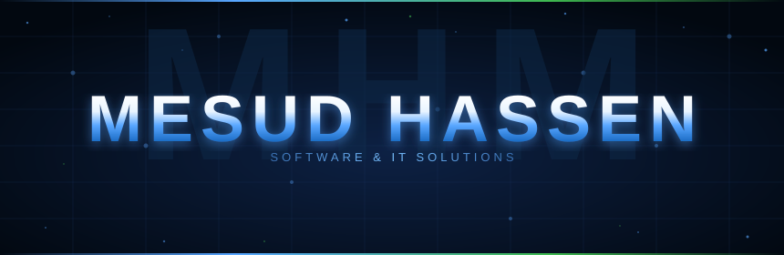

 

<code>{ patience, faith, and focus }</code>

---

I build practical web applications and software systems that solve real-world problems. My interests span full-stack development, databases, software engineering, and network infrastructure. I'm always learning.

---

### Connect

---

### Technologies

**Frontend** &nbsp;

**Backend & DB** &nbsp;

**Mobile** &nbsp;

**OOP & Systems** &nbsp;

**Tools** &nbsp;

**Networking** &nbsp;

`IP · DHCP · DNS · Routing · Switching`

---

### Projects

| Project | Description | Links |
|---------|-------------|-------|
| **Haramaya Land Management** | GIS-enabled land registration and property tax platform for Haramaya Wereda, Ethiopia | [repo](https://github.com/mesudhassen5450-sketch/haramaya_land_management_AI-Map) · [demo](https://haramayalandmanagement.netlify.app/) |
| **Sile Qelbachin** | Islamic educational platform with Kitab, audio lectures, and an admin CMS | [repo](https://github.com/mesudhassen5450-sketch/Sile_qelbachin1) · [site](https://sileqelbachin1.com) |
| **Sile Qelbachin Mobile** | Flutter Android app with Quran, Azkar, prayer times, and Qibla | [repo](https://github.com/mesudhassen5450-sketch/sile-qelabchin--mobile-app) |
| **Blind Assistant Website** | Accessibility-focused web application for visually impaired users | [repo](https://github.com/mesudhassen5450-sketch/Blind-Assistant-website) |
| **Restaurant Management** | Windows desktop app simulating full restaurant order and kitchen workflow | [repo](https://github.com/mesudhassen5450-sketch/Food-Management-Desktop-application-C-) |

---

### GitHub Stats

<!-- Activity stats -->

<!-- Primary stack skills — based on actual project work -->

**Primary Stack** — based on project work

---

<code>{ patience, faith, and focus }</code>

