---

**`{ patience, faith, and focus }`**

---

## Navigation

[About](#-about-me) · [Projects](#-featured-projects) · [Tech Stack](#-technology-stack) · [Networking](#-networking) · [GitHub Activity](#-github-activity) · [Contact](#-contact)

---

## 👋 About Me

I'm **Mesud Hassen**, a full-stack web developer and software developer based in Ethiopia. I build practical web applications and software systems — the kind that solve real-world problems rather than just demonstrate concepts.

My work spans the full development cycle: from designing database schemas and building REST APIs to implementing React frontends and deploying to production. I'm equally interested in the infrastructure layer — networking, systems, and how software actually runs in the real world.

What drives me is the combination of problem-solving and craft. I care about writing clean, maintainable code and building systems that are genuinely useful to the people who use them.

- 🔭 Currently building full-stack applications with **React**, **TypeScript**, and **Supabase**
- 🌱 Deepening my knowledge in **network infrastructure**, **system design**, and **backend architecture**
- 💡 Interested in the intersection of **software engineering** and **network systems**
- 📚 Committed to continuous learning — reading, building, and iterating

---

## 🚀 Featured Projects

### 🗺️ Haramaya Land Management System

> A comprehensive digital platform for land administration, property tax management, and GIS visualization for Haramaya Wereda and Sub-city, Ethiopia.

**What it does:**
- Digital land parcel registration with certificate generation
- Property tax assessment, history, and payment tracking
- Citizen self-service portal for managing assets and disputes
- GIS integration for spatial boundary mapping and visualization
- Bilingual UI — English and Afan Oromo
- Role-based authentication for citizens and administrators

**Stack:** TypeScript · React · PostgreSQL (PLpgSQL) · Supabase · GIS

---

### 📖 Sile Qelbachin — Islamic Educational Platform

> A full-featured Islamic educational platform delivering Kitab, audio lectures (Muhadara), Azkar, and reminders. Includes a public website, an admin CMS, and a companion mobile app.

**What it does:**
- Public website with Kitab library, audio/video content, and article system
- Admin CMS for content management by staff
- Companion Flutter Android app with Quran, Azkar, prayer times, Qibla compass, and offline content
- Amharic and English UI; Arabic content for Quran and Islamic materials
- Supabase backend with structured content schema

**Stack:** TypeScript · React · Supabase · PostgreSQL · Python · Flutter · Dart

---

### 👁️ Blind Assistant Website

> A web application designed to assist visually impaired users, built with React and TypeScript.

**What it does:**
- Assistive web interface targeting accessibility for visually impaired users
- Built with React and TypeScript; accessibility-focused component design

**Stack:** TypeScript · React · CSS

---

### 🍽️ Restaurant Management System (CafeSystem)

> A Windows desktop application simulating a full restaurant workflow — from customer ordering through kitchen processing to payment and revenue tracking.

**What it does:**
- Customer module: food selection, order creation, and payment simulation
- Kitchen workflow: Cook → Ready → Deliver → Finish with live status updates
- Feedback system with ratings and text comments per order
- Revenue dashboard counting only delivered orders
- Event-driven architecture with OOP design

**Stack:** VB.NET · Windows Forms · Object-Oriented Programming

---

### 🌍 Haramaya Land Management Website

> A bilingual public-facing website for the Haramaya land administration system, providing information about land services, news, and a contact system for citizens.

**What it does:**
- Bilingual (English / Afaan Oromoo) responsive website
- Land registration, tax calculation, and permit information
- Community news, gallery, and contact forms
- Smooth animations and mobile-first design

**Stack:** React · Vite · Tailwind CSS · Framer Motion · Supabase

---

### 📱 Sile Qelbachin Mobile App

> Flutter-based Android app companion to the Sile Qelbachin platform — offline-capable Islamic content, prayer times, Qibla, and in-app updates.

**What it does:**
- Quran with surah/juz navigation and offline reciter audio downloads
- Daily Azkar, Tasbeeh, and Kitab PDF library with study notes
- Prayer times via AlAdhan API with timezone-aware scheduling
- Qibla compass and nearby mosque finder
- In-app version checker with Shorebird OTA code push
- Dual-language UI: Amharic and English

**Stack:** Flutter · Dart · Android SDK · Shorebird

---

## 🛠️ Technology Stack

### Frontend

### Backend & Databases

### Mobile

### Tools & Development

### Other Languages

### Networking & Infrastructure

---

## 🌐 Networking

Networking is a meaningful part of my technical direction — not just a course checkbox, but an area I actively study because understanding how systems communicate makes me a better developer.

My practical learning covers:

| Area | Topics |
|------|--------|
| **IP & Addressing** | IPv4/IPv6 addressing, CIDR subnetting, VLSM |
| **Core Protocols** | DHCP, DNS, ARP, TCP/IP stack |
| **Routing & Switching** | Static routing, VLANs, inter-VLAN routing, STP |
| **Device Configuration** | Cisco router and switch CLI, interface config, ACLs |
| **Simulation & Labs** | Cisco Packet Tracer network design and troubleshooting |
| **Troubleshooting** | Connectivity diagnosis, protocol analysis, systematic fault isolation |

I'm especially interested in the relationship between software development and infrastructure: how applications actually reach users, how DNS and routing decisions shape latency and reliability, and how network architecture affects system design.

Understanding both layers — application and infrastructure — is what I'm working toward.

---

## 📊 GitHub Activity

> Stats cards are automated summaries of public repository data. They reflect repository activity, not depth of experience in any given technology.

---

## 💬 Contact

I'm open to collaboration, freelance projects, and conversations about software, networking, and building useful things.

| Channel | Link |
|---------|------|
| 📧 **Email** | [mesudhassen5450@gmail.com](mailto:mesudhassen5450@gmail.com) |
| 💼 **LinkedIn** | [mesud-mesman-837466413](https://www.linkedin.com/in/mesud-mesman-837466413) |
| 🐙 **GitHub** | [@mesudhassen5450-sketch](https://github.com/mesudhassen5450-sketch) |

> **Portfolio website:** The URL on my GitHub profile currently has a formatting issue. The correct link will be added once verified. Check the pinned repositories for live project demos in the meantime.

---

### Explore the work

Browse my [repositories](https://github.com/mesudhassen5450-sketch?tab=repositories) to see what I'm building. Contributions, issues, and collaboration are welcome on any public project.

---

**Mesud Hassen** · Full-Stack Web Developer · Software Developer · Networking Enthusiast

`{ patience, faith, and focus }`

